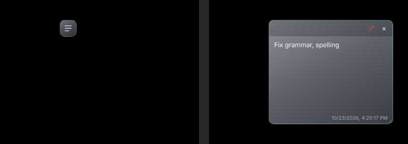

# Hover Notes

A lightweight Chrome extension for sticky notes that live on the page and stay out of the way.

Each note rests as a small grey tab with no text. Hover over it to expand, type, and move away — it collapses back. Notes are saved per page and reappear when you return.

## Features

- **Hover to open** — notes rest as a 34px tab and expand on hover; no clicking
- **Stays open while typing** — collapses when you click away or press `Esc`
- **Pin** (📌) to keep a note permanently open
- **Per-page notes** — tied to the page URL, auto-saved as you type
- **Drag** by the header, **resize** from the corner
- **Three ways to add:** toolbar button, `Alt+Shift+N`, or right-click → *Add sticky note* (selected text goes into the note)
- **Popup dashboard** — search every note across all pages, jump to its page, delete, or export a JSON backup
- **Isolated styling** — rendered in a Shadow DOM, so sites can't break the notes and typing doesn't trigger site shortcuts (Gmail, YouTube, X)
- No accounts, no servers, no tracking — everything stays in your browser

## Install

1. Download this repo: green **Code** button → **Download ZIP**, then extract it.
2. Open `chrome://extensions` in Chrome.
3. Turn on **Developer mode** (top right).
4. Click **Load unpacked** and select the folder containing `manifest.json`.
5. Pin the extension from the puzzle-piece menu.

### Updating

Replace the files in the **same folder**, then click ↻ on the extension card at `chrome://extensions`. Loading from a different folder creates a new extension ID and your saved notes won't carry over — use **Export** in the popup first.

## Limitations

- Notes are stored locally (`chrome.storage.local`) in one Chrome profile; they don't sync across devices.
- Notes match on origin + path; query strings (`?…`) are ignored.
- Chrome doesn't allow extensions on `chrome://` pages, the Chrome Web Store, the new tab page, or the built-in PDF viewer.

## Files

| File | Purpose |
|---|---|
| `manifest.json` | Manifest V3 config |
| `background.js` | Context menu, keyboard shortcut, script injection |
| `content.js` | The notes themselves (Shadow DOM UI, hover logic, storage) |
| `popup.html` / `popup.css` / `popup.js` | Toolbar popup: list, search, export |
| `icons/` | Extension icons |

## License

[MIT](LICENSE)
